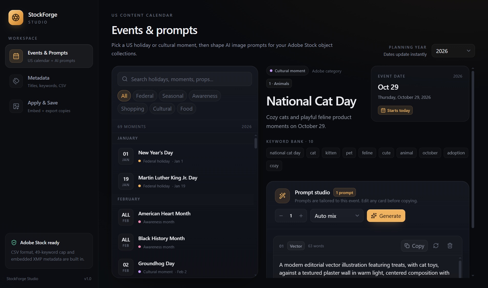
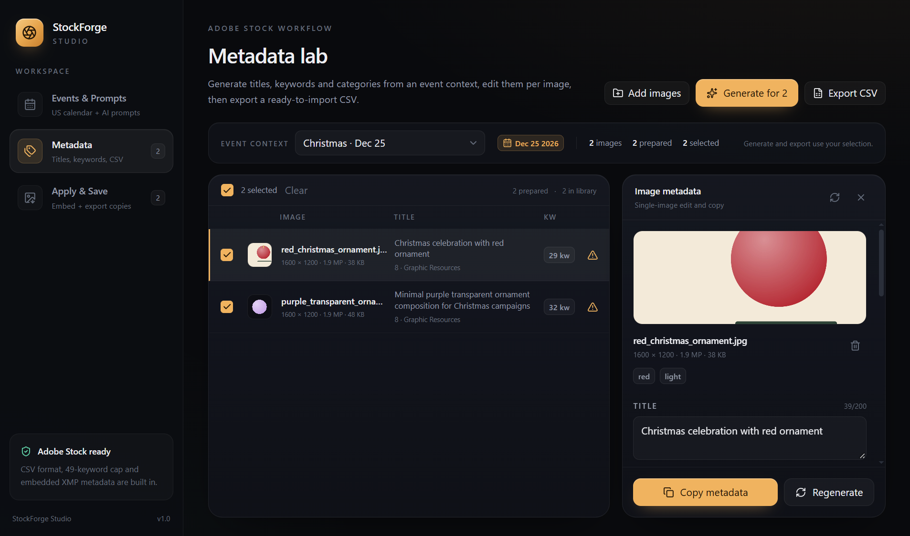
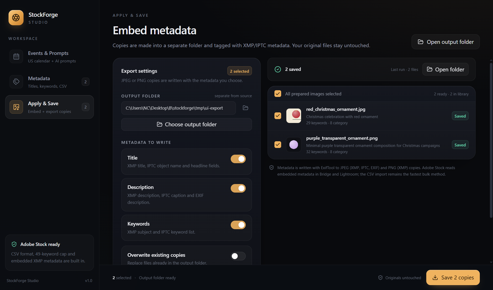

# StockForge Studio

A desktop workspace for selling AI-generated object images on **Adobe Stock**. It connects
the three repetitive parts of the workflow:

1. **US events → AI image prompts**
2. **Images → Adobe Stock metadata → CSV**
3. **Images → embedded metadata → separate output folder**

Built with Electron, React, TypeScript, Tailwind CSS and ExifTool. Metadata generation runs
locally — no API keys, account or network connection required.



## Tabs

### 1. Events & prompts

- 69 curated US holidays, heritage months, shopping moments and seasonal beats.
- Dates are calculated for the selected planning year (2025–2030) — Easter, Thanksgiving
  offsets, election day, lunar dates and more.
- Search by event, prop or keyword; filter by federal, seasonal, awareness, shopping,
  cultural or food.
- Selecting an event seeds **one prompt by default**. Generate 1–12 at a time with an auto,
  photo, 3D, vector, watercolor or minimal style.
- Every prompt is editable, regenerable, removable and copyable. Copy all is available too.
- Prompts are saved per event in local storage, so they survive a restart.

### 2. Metadata lab

- Add one or many JPG/PNG files from the native file picker.
- Pick an event context (or no event) and generate a title, description, keywords and Adobe
  Stock category for every image.
- Reads image dimensions, orientation, brightness, temperature and dominant colors to make
  the metadata more specific.
- Edit title, description, keyword chips, category and release filenames per image.
- **Copy metadata** for a single image from the inspector.
- **Export CSV** in Adobe's five-column format:
  `Filename,Title,Keywords,Category,Releases`
- Shows Adobe Stock limits (4 MP minimum, 100 MP maximum, 45 MB, 49 keywords, 200-character
  title) as warnings while you work.



### 3. Apply & save

- Choose output folder and fields to embed (title, description, keywords).
- Copies selected images into a separate folder and writes metadata with ExifTool:
  - JPEG: XMP title/description/subject + IPTC object name/caption/keywords + EXIF description
  - PNG: XMP title/description/subject
- Originals are never modified. Existing copies are skipped unless overwrite is enabled.
- Live progress, per-file saved/skipped/failed status, and a shortcut to open the output folder.



## Run it

Requirements: Windows 10/11, Node.js 22.12 or newer.

```bash
npm install
npm run dev
```

Create a Windows installer:

```bash
npm run dist:win
```

The installer is written to `release/`. To verify the packaged app without building an
installer, use `npm run pack` and run the app from `release/win-unpacked/`.

### If installation fails on Windows

`electron-builder` pulls a Squirrel helper whose postinstall can fail in some restricted
terminals (`electron-winstaller ... select-7z-arch.js`). Squirrel is not used by this app's
NSIS installer. Install without lifecycle scripts, then download Electron manually:

```bash
npm install --ignore-scripts
node node_modules/electron/install.js
```

## Verify

```bash
npm run typecheck       # main + preload + renderer
npm run build           # production bundles
npm run verify          # calendar/math/metadata/CSV + ExifTool roundtrip
npm run smoke:ui        # builds fixtures, launches Electron and tests the real workflow
```

`smoke:ui` expects a production build (`npm run build`) and writes screenshots to
`screenshots/`. It drives the native dialogs with fixtures, tests prompt edit/remove/copy,
metadata generation, clipboard output, CSV export and the embedded-copy export.

## Notes and limits

- **69 moments, not every unofficial national day.** The set covers the commercially useful
  US calendar: federal holidays, heritage and awareness months, retail moments, seasons and
  major food days.
- Cultural and religious dates in the date tables can shift by a day depending on local
  observance; the UI flags this.
- Metadata is generated from the event, filename tokens, image properties and color
  analysis. It is a starting point — review titles and keywords before uploading.
- The app does not upload to Adobe Stock and does not set Adobe's "Created using generative
  AI tools" flag. Turn that on in the Contributor portal when submitting AI images.
- This project is not affiliated with Adobe.

## Structure

```
src/main       Electron window, protocol, dialogs, CSV writing, ExifTool embedder
src/preload    Typed, context-isolated bridge
src/renderer   React UI, event data, prompt engine, metadata engine, CSV builder
scripts        Core verification, ExifTool roundtrip, UI smoke test, icon generator
```
