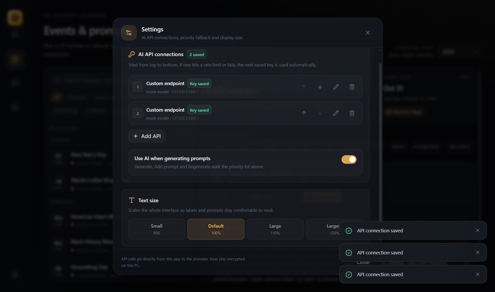

# StockForge Studio

A desktop workspace for selling AI-generated object images on **Adobe Stock**. It connects
the three repetitive parts of the workflow:

1. **US events → AI image prompts**
2. **Images → Adobe Stock metadata → CSV**
3. **Images → embedded metadata → separate output folder**

Built with Electron, React, TypeScript, Tailwind CSS and ExifTool. Metadata generation runs
locally. Prompts work with the built-in offline builder, or with your own OpenAI-compatible
AI API key if you add one in Settings.


## Tabs

### 1. Events & prompts

- 69 curated US holidays, heritage months, shopping moments and seasonal beats.
- Dates are calculated for the selected planning year (2025–2030) — Easter, Thanksgiving
  offsets, election day, lunar dates and more.
- Search by event, prop or keyword; filter by federal, seasonal, awareness, shopping,
  cultural or food.
- Selecting an event seeds **one prompt by default** from the offline builder.
- Generate 1–12 at a time with an auto, photo, 3D, vector, watercolor or minimal style.
- With an AI key saved and enabled, **Generate**, **Add prompt** and **Regenerate** call your
  provider. Without a key they use the offline template engine.
- Every prompt is editable, regenerable, removable and copyable. Copy all is available too.
- Prompts are saved per event in local storage, so they survive a restart.
- The prompt header shows whether AI or the offline builder is active.

### 2. Metadata lab

- Add one or many JPG/PNG files from the native file picker.
- Pick an event context (or no event) and generate a title, description, keywords and Adobe
  Stock category for every image.
- Reads image dimensions, orientation, brightness, temperature and dominant colors to make
  the metadata more specific.
- Edit title, description, keyword chips, category and release filenames per image.
- **Copy metadata** for a single image from the inspector.
- **Export CSV** in Adobe's five-column format:
  `Filename,Title,Keywords,Category,Releases`
- Shows Adobe Stock limits (4 MP minimum, 100 MP maximum, 45 MB, 49 keywords, 200-character
  title) as warnings while you work.


### 3. Apply & save

- Choose output folder and fields to embed (title, description, keywords).
- Copies selected images into a separate folder and writes metadata with ExifTool:
  - JPEG: XMP title/description/subject + IPTC object name/caption/keywords + EXIF description
  - PNG: XMP title/description/subject
- Originals are never modified. Existing copies are skipped unless overwrite is enabled.
- Live progress, per-file saved/skipped/failed status, and a shortcut to open the output folder.


### Settings

Open the gear at the bottom of the sidebar.

- **AI prompt generation** — provider presets for **Priyo Forge** (free, default), **Google AI
  Studio**, **Groq Cloud**, **OpenRouter Free**, Z.ai, OpenAI, OpenRouter, or any custom
  OpenAI-compatible endpoint. Edit the base URL if needed and use **Test connection**.
- Each provider has a **model dropdown** with the supported models and an explicit **Free** or
  **Paid** label. Choose **Custom model…** to enter any model ID not in the list.
- Free options: Priyo Forge (no card, fair-use daily limits), Google AI Studio (free tier),
  Groq Cloud (free tier), OpenRouter Free (`openrouter/free`, roughly 50 requests/day at the
  time of writing), and Z.ai GLM Flash models. Limits and model availability are controlled by
  each provider and can change; switch models or providers in the same panel if needed.
- **Add multiple API connections** with **Add API**. Each connection has its own provider, model
  and encrypted key. Use the ↑/↓ buttons to set priority.
- Prompt generation tries connections **from top to bottom**. If a key is rate-limited, out of
  quota, or the request fails, the next saved key is tried automatically. The success toast shows
  which provider was used and whether a fallback was needed.
- Each API key is encrypted through Electron `safeStorage` in the app's user-data folder. Keys
  are never returned to the renderer, never displayed again after saving, and never logged.
- **Use AI when generating prompts** can be switched off at any time. If no key is saved, the
  offline builder is used automatically.
- **Text size** offers 90%, 100%, 110% and 120%. It scales the whole interface so labels and
  prompt text stay readable, and the choice survives a restart.
- The collapse button beside the logo turns the sidebar into a 72 px icon rail; only icons
  remain, with tooltips. The collapsed state is remembered.



## Run it

Requirements: Windows 10/11, Node.js 22.12 or newer.

```bash
npm install
npm run dev
```

Create a Windows installer:

```bash
npm run dist:win
```

The installer is written to `release/`. To verify the packaged app without building an
installer, use `npm run pack` and run the app from `release/win-unpacked/`.

### If installation fails on Windows

`electron-builder` pulls a Squirrel helper whose postinstall can fail in some restricted
terminals (`electron-winstaller ... select-7z-arch.js`). Squirrel is not used by this app's
NSIS installer. Install without lifecycle scripts, then download Electron manually:

```bash
npm install --ignore-scripts
node node_modules/electron/install.js
```

## Verify

```bash
npm run typecheck       # main + preload + renderer
npm run build           # production bundles
npm run verify          # calendar/math/metadata/CSV + ExifTool roundtrip
npm run smoke:ui        # builds fixtures, launches Electron and tests the real workflow
npm run smoke:settings  # multi-API priority, 429 fallback, encryption, text size (mock API)
```

`smoke:ui` expects a production build (`npm run build`) and writes screenshots to
`screenshots/`. It drives the native dialogs with fixtures, tests prompt edit/remove/copy,
metadata generation, clipboard output, CSV export and the embedded-copy export.

## Notes and limits

- **69 moments, not every unofficial national day.** The set covers the commercially useful
  US calendar: federal holidays, heritage and awareness months, retail moments, seasons and
  major food days.
- **AI generation is optional.** Calls go from the Electron main process directly to the
  provider you configure. Priyo Forge, Gemini, Groq and OpenRouter Free presets are included,
  but their limits apply; paid providers use your credits. The app has no bundled AI key. The
  offline prompt builder and all metadata tools work without any key.
- Cultural and religious dates in the date tables can shift by a day depending on local
  observance; the UI flags this.
- Metadata is generated from the event, filename tokens, image properties and color
  analysis. It is a starting point — review titles and keywords before uploading.
- The app does not upload to Adobe Stock and does not set Adobe's "Created using generative
  AI tools" flag. Turn that on in the Contributor portal when submitting AI images.
- This project is not affiliated with Adobe.

## Structure

```
src/main       Electron window, protocol, dialogs, CSV writing, ExifTool embedder,
               encrypted AI settings and OpenAI-compatible client
src/preload    Typed, context-isolated bridge
src/renderer   React UI, event data, prompt engine, metadata engine, CSV builder
scripts        Core verification, ExifTool roundtrip, UI/settings smoke tests, icon generator
```
